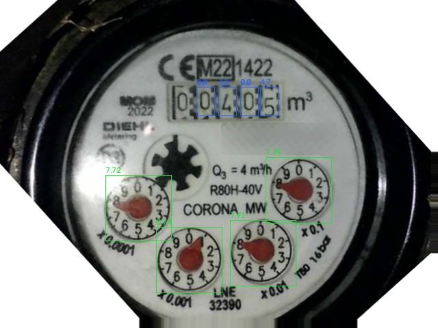

# wasserzaehler-server

Zuverlässiges Ablesen eines Wasserzählers mit **Ziffernrollen und roten Zeigern** – die Fotos
kommen von einer ESP32-CAM mit [AI-on-the-edge-device](https://github.com/jomjol/AI-on-the-edge-device),
ausgewertet wird auf einem kleinen Linux-Rechner (LXC, VM, Pi). Ergebnis per MQTT an Home Assistant.



## Warum?

AI-on-the-edge auf dem ESP32 ist großartig, aber bei manchen Zählern gibt es immer wieder
falsche Werte: Zeiger werden um 180° falsch gelesen, ein falscher Vorwert blockiert das Gerät
tagelang („Rate too high“), und man sieht nicht, wie sicher ein Wert ist. Dieses Projekt lässt
den ESP32 nur noch fotografieren und macht den Rest auf dem Server:

- **Jeder Zeiger doppelt gelesen** – KI-Modell *und* Bildverarbeitung der roten Zeigerspitze.
  Widersprechen sie sich, entscheidet, was zum Nachbarzeiger passt.
- **Die Zeiger prüfen sich gegenseitig** (x0,01 auf 2,4 → x0,001 muss bei etwa 4 stehen).
- **3 Fotos je Messung**, jedes komplett ausgewertet, Median – auch bei laufendem Wasser.
- **Vertrauen 0–100 %** je Messung; unsichere Werte werden nicht veröffentlicht.
- **Kein Festhängen**: unplausible Sprünge werden verworfen, nach 6 stimmigen, sicheren Messungen aber übernommen.
- **Beschlagenes Glas** (kaltes Wasser!) wird am Kontrast der Ziffernrollen erkannt – dann zählen
  nur die Zeiger, die ganzen m³ kommen aus dem letzten Stand.
- **Ausrichtung mit vielen Bildmerkmalen** – eine wandernde Kamera stört nicht.
- **Archiv** aller Messungen mit Fotos, Webseite zum Nachprüfen.
- Home-Assistant-**Discovery**: Zählerstand (Energie-Dashboard), Durchfluss, Vertrauen, Bild, Knöpfe.

Feldtest: 111 Messungen über Nacht, kein einziger falscher Wert veröffentlicht, 83 von 91
Vergleichen mit den Rohwerten des ESP32 auf 0,5 L gleich (Rest: Zeitversatz bei laufendem Wasser).
Einmal las die KI einen Zeiger um 180° falsch – das Spitzenverfahren hat es abgefangen.
In der zweiten Nacht beschlug das Sichtfenster stundenlang; Version 0.1.0 las die Rollen dann als
„0005“ und übernahm das – seit 0.2.0 wird das erkannt (Nachrechnung: lückenlos richtige Reihe).

## Schnellstart

```bash
git clone https://github.com/Lethyros/wasserzaehler-server.git
cd wasserzaehler-server
./system/deploy.sh root@<linux-rechner>          # oder auf dem Rechner: bash system/install.sh

# auf dem Rechner:
wasserzaehler uebernehmen <IP-der-ESP32-CAM>     # Lesebereiche, Drehung, Referenzbild, Modelle
nano /opt/wasserzaehler/config.toml              # [mqtt] host
nano /etc/wasserzaehler.env                      # MQTT-Benutzer/Passwort
systemctl restart wasserzaehler
# Webseite: http://<linux-rechner>:8080
```

Voraussetzung: AI-on-the-edge ist eingerichtet und liest den Zähler grundsätzlich (Lesebereiche
mittig, class100-Modelle). Tipps zu Schärfe, Zoom und Lesebereichen stehen in der Dokumentation.

📖 **[Vollständige Dokumentation](docs/DOKUMENTATION.md)** – Installation, Konfiguration,
Funktionsweise, MQTT-Referenz, Fehlersuche, Testbericht.

## Lizenz

MIT. Die KI-Modelle stammen aus AI-on-the-edge-device (Lizenz: privat frei, kommerziell nur mit
Lizenz) und sind **nicht** enthalten – `wasserzaehler uebernehmen` holt sie von der eigenen Kamera.
Siehe [DRITTANBIETER.md](DRITTANBIETER.md).

---

## English summary

`wasserzaehler-server` reads water meters with digit rolls **and red analog pointers** reliably.
An ESP32-CAM running [AI-on-the-edge-device](https://github.com/jomjol/AI-on-the-edge-device) only
takes the pictures; a small Linux box does the evaluation and publishes to MQTT / Home Assistant
(auto discovery).

- every pointer is read twice: the AI-on-the-edge CNN *and* classic image processing of the red
  pointer tip (fixes the typical 180° misreadings); pointers are cross-checked against each other
- 3 photos per reading, each fully evaluated, median; confidence score 0–100, low-confidence
  readings are not published
- plausibility check that never gets stuck (re-sync after 6 consistent, confident readings)
- fogged meter glass (condensation from cold water) is detected via digit-roll contrast; the
  integer m³ then come from the last reading, only the pointers are read
- feature-based alignment (ORB), archive with photos, small web UI
- `wasserzaehler uebernehmen <esp32-ip>` imports ROIs, rotation, reference image and models
  from your camera

Documentation is in German ([docs/DOKUMENTATION.md](docs/DOKUMENTATION.md)); code identifiers are
German too. Issues and pull requests in English are welcome.
